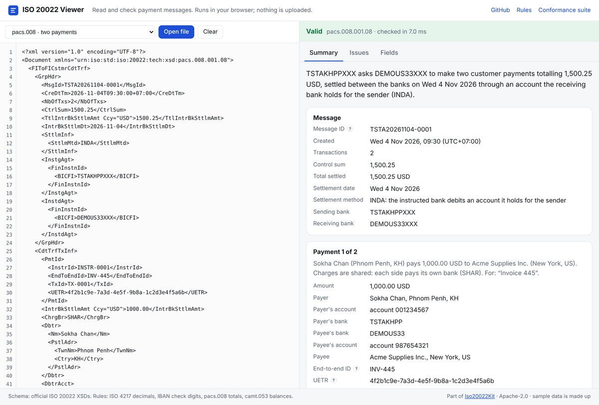
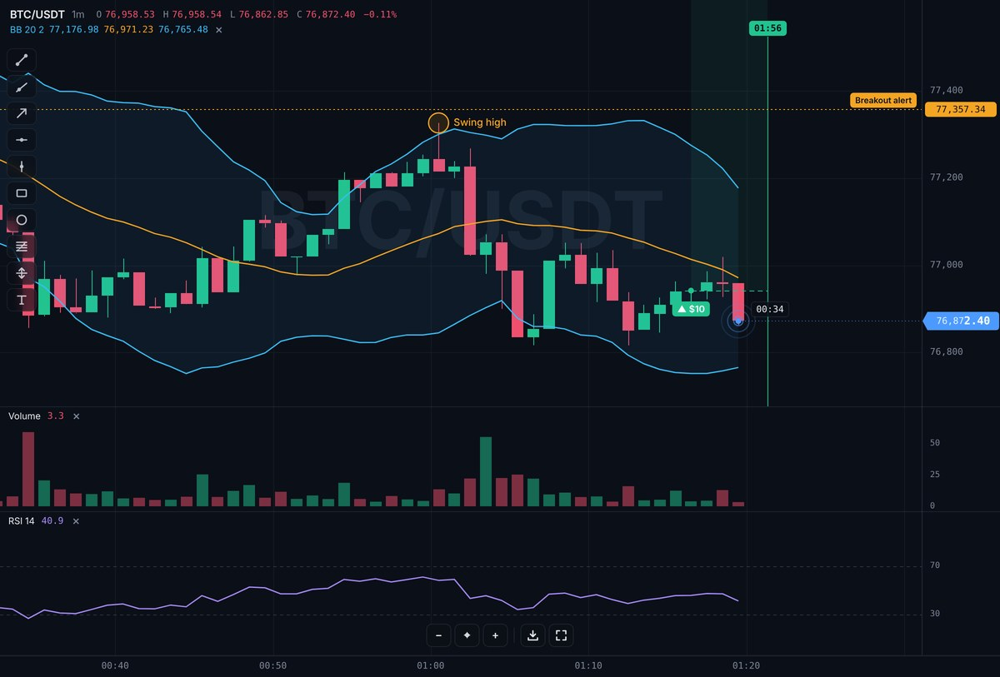
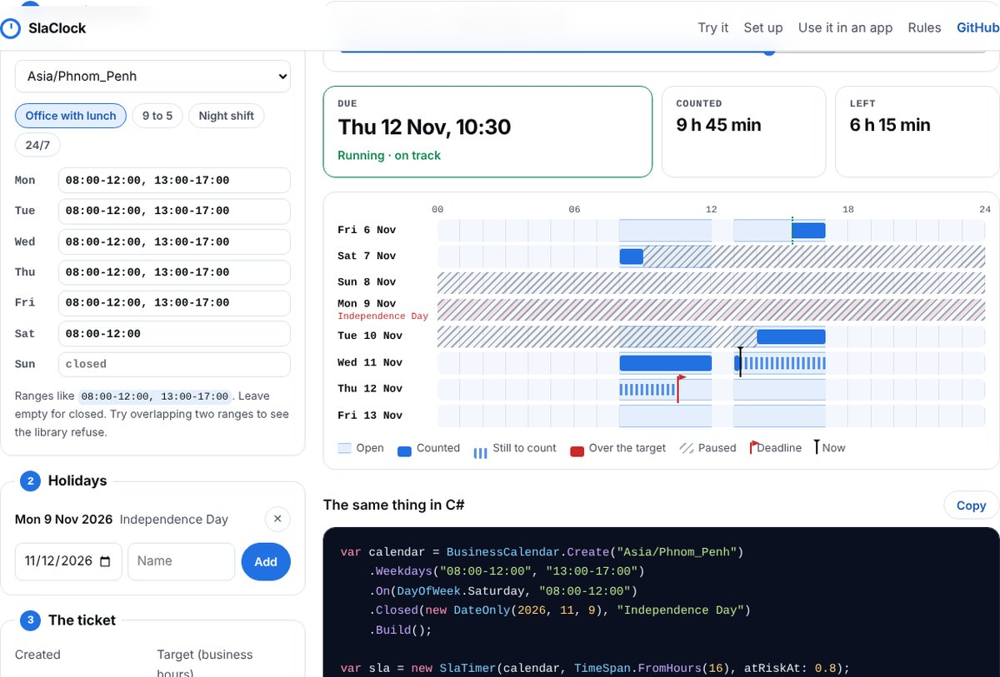

<picture>
  <source media="(prefers-color-scheme: dark)" srcset="./assets/banner-dark.svg">
  
</picture>

  <a href="https://vongvisalsambath.vercel.app"><b>Portfolio</b></a>
  &nbsp;·&nbsp;
  <a href="https://vongvisalsambath.vercel.app/assets/Vong_Visalsambath_Resume.pdf"><b>Resume (PDF)</b></a>
  &nbsp;·&nbsp;
  <a href="mailto:vongvisalsambath@gmail.com"><b>Email</b></a>

## About

I'm a Senior Enterprise Service Engineer at **CIMB Bank** in Phnom Penh. I build enterprise applications end to end: the interface, the backend, the database, and the deployment to production. I've been building for the web since 2016.

> The system should handle the complexity, so the user doesn't have to.

## Selected work

Both are internal banking systems, so their code isn't public. Each one is drawn here as what it is: the layers, the people, and the numbers.

  
  

**GDT tax payment platform** · live since late 2025 
Branch staff collect property, vehicle and land tax through the web application we built. One shared .NET core serves the branch web app and the bank's mobile app (built by the bank's mobile team), and integrates with core banking and the government tax API. **≈ 100,000 transactions** since go-live, growing month on month. 
Angular · C# / .NET · PostgreSQL · PL/pgSQL

**Connect Hub** · lead developer · 2026 
A bank-wide complaint management platform. Any staff member raises a complaint, the owning department resolves it, the Call Centre verifies with the customer, and a central unit administers and reports. **12 weeks** from mockup to production handover, with six roles in one workflow and three regulatory report types automated. 
.NET 8 · Angular 18 · PostgreSQL · Docker · nginx

## Open source

**[Iso20022Kit](https://iso20022-viewer.vercel.app)** · read, write and check ISO 20022 payment messages · **[Open the viewer →](https://iso20022-viewer.vercel.app)** · [GitHub](https://github.com/vongvisalsambath/iso20022kit) 
ISO 20022 is the format banks now use for transfers and statements. A .NET library checks pacs.008 and camt.053 messages against the official schema and the rules a bank checks (totals, statement balances, currency decimals, IBAN check digits), and a browser viewer explains any message in plain English without uploading it. A 45-message conformance suite runs against Java, Go and Rust libraries, with [the bugs found in each](https://github.com/vongvisalsambath/iso20022kit/blob/main/docs/comparison.md) published; the .NET library and the viewer give the same verdict on every case. It also translates between SWIFT MT103 and pacs.008, listing what each translation loses. Hardened against hostile input (XXE, entity bombs, validation bypass, hidden characters). 
C# · .NET 8 / 10 · XML Schema · TypeScript · Playwright · GitHub Actions

**[Tickline](https://tickline-chart.vercel.app)** · a live trading chart for any website, in one HTML tag · **[Live demo →](https://tickline-chart.vercel.app)** · [Docs](https://tickline-chart.vercel.app/docs/) · [GitHub](https://github.com/vongvisalsambath/tickline) 
Smooth real-time candles, six chart types, indicators, ten drawing tools, positions and price alerts, history that loads as you scroll back, zoom, shapes and custom layers drawn from code, full screen in portrait or landscape, and image export, in about 38 KB with no dependencies. Works in plain HTML, React, Vue, Angular, Svelte and Blazor, with more than 150 documented settings. Ships an MCP server and a Claude Code plugin so AI assistants can add it to a project. 128 tests. 
TypeScript · Canvas 2D · Web Components · Vitest · esbuild · MCP

**[SlaClock](https://slaclock.vercel.app)** · business-hours deadlines and pausable SLA timers for .NET · **[Try it in your browser →](https://slaclock.vercel.app)** · [GitHub](https://github.com/vongvisalsambath/slaclock) 
"Respond within 16 business hours", done properly: weekly hours with lunch breaks and night shifts, holidays and half days, any time zone with daylight saving handled, and a timer that pauses while you wait on the customer. 62 tests on .NET 8 and .NET 10, run on Linux, Windows and macOS. 
C# · .NET 8 / 10 · xUnit · Blazor WebAssembly · GitHub Actions

### Banking toolkits

Six smaller open-source tools for everyday banking work. Each has a website that runs entirely in the browser, so nothing typed or uploaded leaves the device, and each has its own tests and security review.

| Project | What it does | Built with |
|---|---|---|
| **[Amortizer](https://amortizer-steel.vercel.app)** · [GitHub](https://github.com/vongvisalsambath/amortizer) | What does this loan really cost? Full payment schedules with exact decimal arithmetic, and the true yearly cost (APR) including fees. | .NET · Blazor |
| **[Payee](https://payee-qr.vercel.app)** · [GitHub](https://github.com/vongvisalsambath/payee-qr) | Who does this payment QR really pay? Reads KHQR, PromptPay, DuitNow, QRIS, VietQR, PayNow and SGQR codes and checks them against EMVCo's rules. | TypeScript · npm |
| **[LedgerKit](https://ledgerkit-rose.vercel.app)** · [GitHub](https://github.com/vongvisalsambath/ledgerkit) | A double-entry ledger that refuses unbalanced or edited entries, enforced by PostgreSQL itself, and bank reconciliation against camt.053 statements. | .NET · PostgreSQL |
| **[Iso8583Kit](https://iso8583kit.vercel.app)** · [GitHub](https://github.com/vongvisalsambath/iso8583kit) | Read, build and explain ISO 8583 card messages, with a simulated card host for testing terminals. | .NET · TCP |
| **[SanctionScreen](https://sanctionscreen.vercel.app)** · [GitHub](https://github.com/vongvisalsambath/sanctionscreen) | Screen a name against OFAC's sanctions list. Copes with typos, word order, accents and initials, and every possible match says why. | .NET · Blazor |
| **[TxMonitor](https://txmonitor.vercel.app)** · [GitHub](https://github.com/vongvisalsambath/txmonitor) | Anti-money-laundering rules over a file of transactions (structuring, pass-through, bursts, dormant accounts), each alert explained with its numbers. | .NET · Blazor |

## Stack

| Layer | What I use |
|---|---|
| **Frontend** | Angular · TypeScript · HTML & CSS · React · Vue / Nuxt |
| **Backend** | C# · ASP.NET Core · Node.js / Express · REST APIs · JWT |
| **Data** | PostgreSQL · PL/pgSQL · SQL · MySQL · Redis |
| **Infrastructure** | Docker · Jenkins CI/CD · nginx · Linux / Ubuntu · Kubernetes |
| **Production** | Monitoring · root-cause analysis · SIT / UAT · release support |

## How I work

1. **Start with the people, not the code.** Who does each step, what they wait for, where mistakes happen, and what "better" would mean for them.
2. **Build every layer it touches.** Interface, API, services, data and infrastructure, designed together so every channel behaves the same way.
3. **Ready for the people who operate it.** Monitoring, incident investigation, root-cause analysis and permanent fixes. Documentation and operating procedures are part of the system.

## Experience

| When | Role |
|---|---|
| 2025 – now | **Senior Enterprise Service Engineer**, CIMB Bank PLC |
| 2023 – 2025 | **Senior Full Stack Developer**, SALA Digital Solution |
| 2019 – 2023 | **Senior Full Stack Developer** (team lead), Melos Co., Ltd |
| 2018 – 2019 | **Full-time English study**, Paññasastra University of Cambodia |
| 2017 – 2018 | **Senior Web Developer & IT Support**, Japara Cambodia |
| 2016 – 2017 | **Software Developer**, Innovation International Group |
| 2013 – 2016 | **BSc Computer Science**, Royal University of Phnom Penh · GPA 3.83 |

Phnom Penh, Cambodia · open to conversations about enterprise and full stack engineering roles and projects

