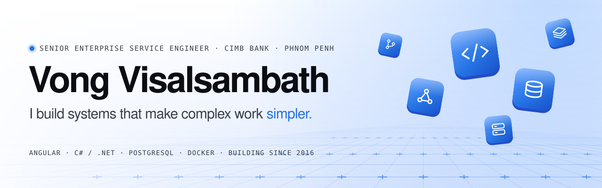
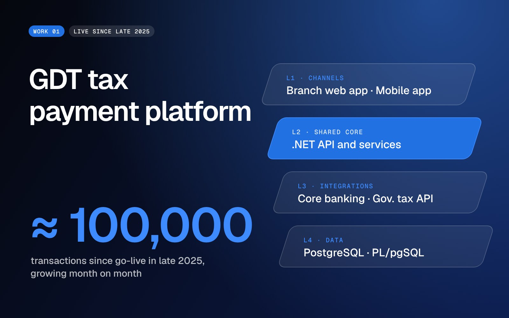
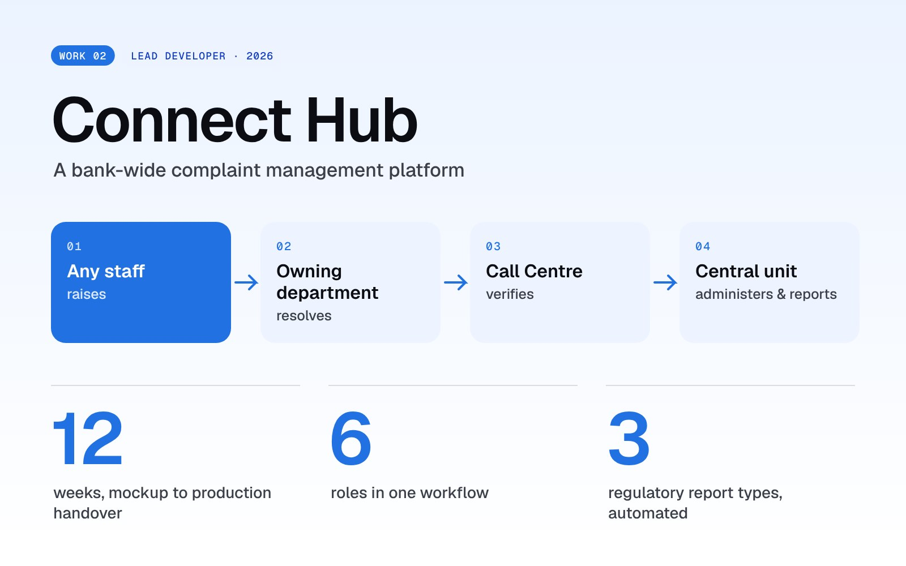

<picture>
  <source media="(prefers-color-scheme: dark)" srcset="./assets/banner-dark.svg">
  
</picture>

  <a href="https://vongvisalsambath.vercel.app"><b>Portfolio</b></a>
  &nbsp;·&nbsp;
  <a href="https://vongvisalsambath.vercel.app/assets/Vong_Visalsambath_Resume.pdf"><b>Resume (PDF)</b></a>
  &nbsp;·&nbsp;
  <a href="mailto:vongvisalsambath@gmail.com"><b>Email</b></a>

## About

I'm a Senior Enterprise Service Engineer at **CIMB Bank** in Phnom Penh. I build enterprise applications end to end: the interface, the backend, the database, and the deployment to production. I've been building for the web since 2016.

> The system should handle the complexity, so the user doesn't have to.

## Selected work

Both are internal banking systems, so their code isn't public. Each one is drawn here as what it is: the layers, the people, and the numbers.

  
  

**GDT tax payment platform** · live since late 2025 
Branch staff collect property, vehicle and land tax through the web application we built. One shared .NET core serves the branch web app and the bank's mobile app (built by the bank's mobile team), and integrates with core banking and the government tax API. **≈ 100,000 transactions** since go-live, growing month on month. 
Angular · C# / .NET · PostgreSQL · PL/pgSQL

**Connect Hub** · lead developer · 2026 
A bank-wide complaint management platform. Any staff member raises a complaint, the owning department resolves it, the Call Centre verifies with the customer, and a central unit administers and reports. **12 weeks** from mockup to production handover, with six roles in one workflow and three regulatory report types automated. 
.NET 8 · Angular 18 · PostgreSQL · Docker · nginx

## Stack

| Layer | What I use |
|---|---|
| **Frontend** | Angular · TypeScript · HTML & CSS · React · Vue / Nuxt |
| **Backend** | C# · ASP.NET Core · Node.js / Express · REST APIs · JWT |
| **Data** | PostgreSQL · PL/pgSQL · SQL · MySQL · Redis |
| **Infrastructure** | Docker · Jenkins CI/CD · nginx · Linux / Ubuntu · Kubernetes |
| **Production** | Monitoring · root-cause analysis · SIT / UAT · release support |

## How I work

1. **Start with the people, not the code.** Who does each step, what they wait for, where mistakes happen, and what "better" would mean for them.
2. **Build every layer it touches.** Interface, API, services, data and infrastructure, designed together so every channel behaves the same way.
3. **Ready for the people who operate it.** Monitoring, incident investigation, root-cause analysis and permanent fixes. Documentation and operating procedures are part of the system.

## Experience

| When | Role |
|---|---|
| 2025 – now | **Senior Enterprise Service Engineer**, CIMB Bank PLC |
| 2023 – 2025 | **Full Stack Developer**, SALA Digital Solution |
| 2019 – 2023 | **Full Stack Developer** (team lead), Melos Co., Ltd |
| 2018 – 2019 | **Full-time English study**, Paññasastra University of Cambodia |
| 2017 – 2018 | **Web Developer & IT Support**, Japara Cambodia |
| 2016 – 2017 | **Software Developer**, Innovation International Group |
| 2013 – 2016 | **BSc Computer Science**, Royal University of Phnom Penh · GPA 3.83 |

Phnom Penh, Cambodia · open to conversations about enterprise and full stack engineering roles and projects

